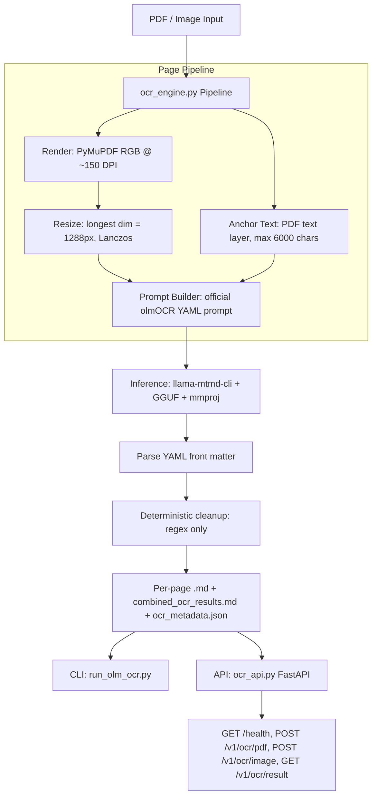

# 📄 OlmOCR — Production Tamil & English Document OCR

[](https://www.python.org/)
[](https://fastapi.tiangolo.com/)
[](https://huggingface.co/allenai/olmOCR-2-7B-1025)
[](https://github.com/ggml-org/llama.cpp)
[](https://www.docker.com/)
[](https://opensource.org/licenses/MIT)

Production-grade OCR pipeline for Tamil + English documents (including legal / dense layouts). Renders PDF pages to the exact Allen AI vision spec (`target_longest_image_dim=1288`), injects PDF-layer anchor text into the official olmOCR prompt, runs inference via `llama-mtmd-cli` (GGUF), and returns structured Markdown + metadata through a FastAPI service or a CLI.

> Showcase / portfolio repo. No secrets are committed — all model paths, keys, and endpoint hosts are sample placeholders you override locally (see `.env.example`).

Based on [allenai/olmocr](https://github.com/allenai/olmocr) and [allenai/olmOCR-2-7B-1025](https://huggingface.co/allenai/olmOCR-2-7B-1025).

---

## 📌 Table of Contents

- [Key Architecture & Data Flow](#-key-architecture--data-flow)
- [Core Features](#-core-features)
- [Project Structure](#-project-structure)
- [Getting Started](#️-getting-started)
  - [Prerequisites](#prerequisites)
  - [Installation & Setup](#installation--setup)
  - [Download Sample Model Weights](#download-sample-model-weights)
- [Running Locally](#-running-locally)
  - [CLI](#cli)
  - [API Server](#api-server)
- [API Reference (Sample Endpoints)](#-api-reference-sample-endpoints)
- [Configuration & Environment Variables](#️-configuration--environment-variables)
- [Output Schema](#-output-schema)
- [Docker](#-docker)
- [Kubernetes](#-kubernetes)
- [Testing & Validation](#-testing--validation)
- [Console Output Preview](#️-console-output-preview)
- [Notes on Accuracy](#-notes-on-accuracy)
- [License](#-license)

---

## 🏗️ Key Architecture & Data Flow



---

## 🚀 Core Features

- **📐 Allen-AI-Compatible Rendering**:
  - RGB render at ~150 DPI, then Lanczos resize so the longest side is exactly `1288px`.
  - Avoids the common `2048px` mistake that breaks the vision encoder's patch sizes.

- **⚓ Anchor-Text Injection**:
  - Extracts up to `6000` chars from the PDF text layer (reading-order sorted) and injects it as reference context.
  - Large accuracy boost on born-digital PDFs; safely empty on scanned pages.

- **📝 Official Prompt Format**:
  - YAML front-matter prompt (`primary_language`, `is_rotation_valid`, `rotation_correction`, `is_table`, `is_diagram`).
  - Tables → HTML, equations → LaTeX, figures → ``.

- **🧹 Non-Destructive Preprocessing**:
  - No CLAHE / threshold / deskew / denoise. Only RGB conversion + resize.
  - Preserves Tamil glyph detail the VLM recovers itself.

- **⚡ Production API + CLI**:
  - FastAPI with job IDs, per-page timing, combined Markdown, and metadata JSON.
  - Optional `Bearer` API key (env-gated, disabled when unset).
  - CLI with page selection (`all`, `1`, `1-5`, `3,5`), colored console output, UTF-8 safe on Windows.

- **🐳 Docker & ☸️ K8s Ready**:
  - Multi-stage Dockerfile with healthcheck.
  - Sample Deployment / Service / Ingress manifests using placeholder hosts and `secretKeyRef` (no hardcoded secrets).

---

## 📂 Project Structure

```text
olm-ocr/
├── ocr_engine.py            # Core pipeline: render → resize → anchor → prompt → inference → cleanup
├── ocr_api.py               # FastAPI server (sample endpoints, see below)
├── run_olm_ocr.py           # CLI wrapper around ocr_engine
├── requirements.txt         # Python dependencies
├── Dockerfile               # Multi-stage production image
├── download-cmd.txt         # Sample Hugging Face model download commands
├── .env.example             # Sample configuration template (copy to .env)
├── .gitignore               # Excludes secrets, models, runtime artifacts
├── run_ocr.bat              # Windows CMD wrapper (sample paths)
├── run_ocr.ps1              # PowerShell wrapper (sample paths)
├── k8s/
│   ├── deployment.yaml      # Sample Deployment (placeholder image + secretKeyRef)
│   ├── service.yaml         # ClusterIP Service
│   └── ingress.yaml         # Sample Ingress (ocr.example.com)
├── samples/
│   └── README.md            # Where to place local test files (not committed)
├── uploads/                 # Runtime upload dir (gitkept, empty in repo)
├── ocr_output/              # API runtime output dir (gitkept, empty in repo)
└── ocr_results/             # CLI runtime output dir (gitkept, empty in repo)
```

---

## 🛠️ Getting Started

### Prerequisites

- **Python**: `3.10` or higher
- **llama.cpp `llama-mtmd-cli`**: built with multimodal (`mtmd`) support and available on `PATH`
  (or set `OCR_CLI_PATH` / `--cli` to its location)
- **Model weights** (GGUF, downloaded separately — not committed):
  - e.g. `olmOCR-2-7B-1025-Q5_K_M.gguf` (or `Q8_0`)
  - matching `mmproj-*.gguf`
  - See `download-cmd.txt` and [bartowski/allenai_olmOCR-2-7B-1025-GGUF](https://huggingface.co/bartowski/allenai_olmOCR-2-7B-1025-GGUF)

### Installation & Setup

1. **Clone the repository:**
   ```bash
   git clone https://github.com/YOUR_USERNAME/olm-ocr.git
   cd olm-ocr
   ```

2. **Create and activate a virtual environment:**
   ```bash
   # On macOS/Linux:
   python3 -m venv .venv
   source .venv/bin/activate

   # On Windows (PowerShell):
   python -m venv .venv
   .venv\Scripts\Activate.ps1
   ```

3. **Install dependencies:**
   ```bash
   pip install --upgrade pip
   pip install -r requirements.txt
   ```

4. **Prepare environment configuration (optional):**
   ```bash
   cp .env.example .env
   ```
   Edit `.env` to point at your local model paths (see [Configuration](#️-configuration--environment-variables)).

### Download Sample Model Weights

See `download-cmd.txt` (sample commands only):

```bash
pip install "huggingface_hub[cli]"

huggingface-cli download bartowski/allenai_olmOCR-2-7B-1025-GGUF \
  --include "olmOCR-2-7B-1025-Q5_K_M.gguf" --local-dir "./models"

huggingface-cli download bartowski/allenai_olmOCR-2-7B-1025-GGUF \
  --include "mmproj*.gguf" --local-dir "./models"
```

---

## ▶️ Running Locally

### CLI

```bash
# PDF (all pages)
python run_olm_ocr.py --pdf samples/document.pdf --output ./ocr_results

# Specific pages
python run_olm_ocr.py --pdf samples/document.pdf --pages "1,3,5-7" --output ./ocr_results

# Single image
python run_olm_ocr.py --image samples/page.png --output ./ocr_results

# Explicit model paths (overrides env / defaults)
python run_olm_ocr.py --pdf samples/document.pdf \
  --model ./models/olmOCR-2-7B-1025-Q8_0.gguf \
  --mmproj ./models/mmproj-olmOCR-2-7B-1025-f16.gguf \
  --cli llama-mtmd-cli
```

Windows helpers (sample paths inside):

```bat
run_ocr.bat --pdf "samples\document.pdf"
```

```powershell
.\run_ocr.ps1 --pdf "samples\document.pdf" --pages "1,3,5-7"
.\run_ocr.ps1 --image "samples\page.png"
```

### API Server

```bash
# Default: http://localhost:8003
python ocr_api.py --host 0.0.0.0 --port 8003

# With explicit paths
python ocr_api.py \
  --model ./models/olmOCR-2-7B-1025-Q8_0.gguf \
  --mmproj ./models/mmproj-olmOCR-2-7B-1025-f16.gguf \
  --cli llama-mtmd-cli
```

Interactive docs (sample local endpoint):

```text
http://localhost:8003/docs
http://localhost:8003/health
```

---

## 🔌 API Reference (Sample Endpoints)

All hosts below are **samples**. Replace with your deployment host.

| Method | Endpoint | Description | Sample |
|:---|:---|:---|:---|
| `GET` | `/health` | Liveness + model/CLI availability | `curl http://localhost:8003/health` |
| `POST` | `/v1/ocr/pdf` | OCR a PDF (`multipart/form-data`: `file`, `pages="all"`) | see below |
| `POST` | `/v1/ocr/image` | OCR a single image (`multipart/form-data`: `file`) | see below |
| `GET` | `/v1/ocr/result/{job_id}` | Download combined Markdown for a job | `curl http://localhost:8003/v1/ocr/result/<job_id>` |
| `GET` | `/v1/ocr/result/{job_id}/metadata` | Download `ocr_metadata.json` for a job | `curl http://localhost:8003/v1/ocr/result/<job_id>/metadata` |

Sample requests:

```bash
# Health
curl -s http://localhost:8003/health

# PDF OCR (pages: "all", "1", "1-5", "3,5")
curl -s -X POST http://localhost:8003/v1/ocr/pdf \
  -F "file=@samples/document.pdf" \
  -F "pages=all"

# Image OCR
curl -s -X POST http://localhost:8003/v1/ocr/image \
  -F "file=@samples/page.png"

# Fetch a previous result
curl -s http://localhost:8003/v1/ocr/result/<job_id> -o result.md
curl -s http://localhost:8003/v1/ocr/result/<job_id>/metadata
```

Optional auth (only when `OCR_API_KEY` is set):

```bash
curl -s http://localhost:8003/v1/ocr/pdf \
  -H "Authorization: Bearer <YOUR_KEY>" \
  -F "file=@samples/document.pdf" -F "pages=all"
```

Sample `POST /v1/ocr/pdf` response:

```json
{
  "job_id": "a1b2c3d4",
  "source_filename": "document.pdf",
  "total_pages": 2,
  "processed_pages": 2,
  "total_elapsed_seconds": 42.5,
  "pages": [
    {
      "page_num": 1,
      "page_type": "text",
      "dpi": 150,
      "char_count": 3120,
      "elapsed_seconds": 21.1,
      "text": "---\nprimary_language: ta\n..."
    }
  ],
  "combined_markdown": "# --- PAGE 1 ---\n\n...",
  "output_dir": "./ocr_output/a1b2c3d4"
}
```

---

## ⚙️ Configuration & Environment Variables

All settings can be overridden via environment variables, a `.env` file, or CLI flags:

| Variable | Default | Description |
|:---|:---:|:---|
| `OCR_MODEL_PATH` | `./models/olmOCR-2-7B-1025-Q8_0.gguf` | Path to the GGUF model weights. |
| `OCR_MMPROJ_PATH` | `./models/mmproj-olmOCR-2-7B-1025-f16.gguf` | Path to the matching mmproj file. |
| `OCR_CLI_PATH` | `llama-mtmd-cli` | Path to the `llama-mtmd-cli` binary. |
| `OCR_GPU_LAYERS` | `999` | GPU layers to offload (`-ngl`). |
| `OCR_MAX_TOKENS` | `6144` | Max output tokens (`-n`). |
| `OCR_CTX_SIZE` | `8192` | Context size (`--ctx-size`). |
| `OCR_UPLOAD_DIR` | `./uploads` | API upload staging directory. |
| `OCR_OUTPUT_DIR` | `./ocr_output` | API job output directory. |
| `OCR_API_KEY` | *(empty = disabled)* | Optional Bearer token for API auth. |

---

## 📑 Output Schema

Each run produces:

```text
<output_dir>/
├── rendered_pages/page-001.png      # RGB render (~150 DPI)
├── processed_pages/page-001_proc.png # Resized to 1288px longest dim
├── pages/page-001.md                # Per-page Markdown
├── logs/live_page-001_proc.log      # Raw inference log
├── combined_ocr_results.md          # All pages concatenated
└── ocr_metadata.json                # Structured metadata
```

Sample `ocr_metadata.json`:

```json
{
  "source": "samples/document.pdf",
  "total_pages": 2,
  "processed_pages": 2,
  "timestamp": "2026-09-29T10:00:00",
  "pages": [
    {
      "page_num": 1,
      "page_type": "text",
      "dpi": 150,
      "elapsed_seconds": 21.1,
      "char_count": 3120,
      "primary_language": "ta",
      "is_table": false,
      "is_diagram": false
    }
  ]
}
```

---

## 🐳 Docker

```bash
# Build
docker build -t olm-ocr:local .

# Run (sample — mount your local models, uploads, output)
docker run --rm -p 8003:8003 \
  -e OCR_MODEL_PATH=/models/olmOCR-2-7B-1025-Q8_0.gguf \
  -e OCR_MMPROJ_PATH=/models/mmproj-olmOCR-2-7B-1025-f16.gguf \
  -e OCR_CLI_PATH=/usr/local/bin/llama-mtmd-cli \
  -v ./models:/models:ro \
  -v ./ocr_output:/ocr_output \
  olm-ocr:local

# Health
curl -s http://localhost:8003/health
```

---

## ☸️ Kubernetes

Sample manifests in `k8s/` use placeholder values — replace `YOUR_USERNAME`, `ocr.example.com`, and wire `olmocr-secrets` in your cluster:

```bash
# Create the optional API-key secret (sample)
kubectl -n ocr-system create secret generic olmocr-secrets \
  --from-literal=api-key='<YOUR_KEY>'

# Deploy (sample namespace: ocr-system)
kubectl apply -f k8s/
kubectl -n ocr-system get pods,svc,ingress
```

Sample endpoint after ingress setup:

```text
https://ocr.example.com/health
https://ocr.example.com/docs
```

---

## 🧪 Testing & Validation

Syntax + import check (no model weights required):

```bash
python -m py_compile ocr_api.py ocr_engine.py run_olm_ocr.py
python run_olm_ocr.py --help
```

Unit-check pure helpers (requires `pymupdf`, `pillow`):

```bash
python -c "from ocr_engine import parse_pages, build_prompt, deterministic_cleanup; print(parse_pages('1,3,5-7', 10))"
```

Live check (requires model weights + `llama-mtmd-cli`):

```bash
python run_olm_ocr.py --image samples/page.png --output ./ocr_results
curl -s http://localhost:8003/health
```

---

## 🖥️ Console Output Preview

```text
============================================================
  OlmOCR Production Pipeline
============================================================

[*] Source: samples/document.pdf
[*] Pages:  all
[*] Output: ./ocr_results

Processing page 1 (1/2)...
Processing page 2 (2/2)...

------------------------------------------------------------
[OK] Processed 2 pages
    Page   1  |  text    |  150 DPI  |   3120 chars  |  21.1s
    Page   2  |  table   |  150 DPI  |   2874 chars  |  20.8s

[OK] Combined output: ./ocr_results/combined_ocr_results.md
[OK] Metadata:        ./ocr_results/ocr_metadata.json
```

---

## 📌 Notes on Accuracy

- The `1288px` resize and anchor-text injection are the two highest-leverage details carried over from the official pipeline.
- Keep preprocessing minimal: grayscale conversion, CLAHE, and thresholding measurably hurt Tamil glyph recovery in this setup.
- The model returns a YAML front matter block — always parse and strip it before downstream use (`parse_ocr_response` handles this).

---

## 📄 License

This project is licensed under the [MIT License](LICENSE) — add a `LICENSE` file with the MIT text before publishing if you want the badge link to resolve.
